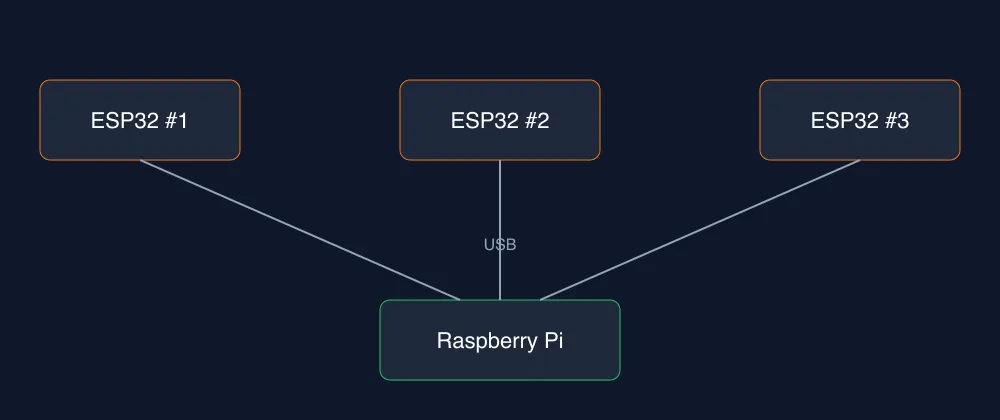

> Reconstructing an environment in 3D in real time is nowhere near possible, but with ESP32 and Wi-Fi CSI I can try something more modest: seeing the presence cloud of someone moving around.

It all started with a scene from Prometheus: flying robots scanning caves and mapping every maze in real time. I started looking into what it would take to do something like that. My conclusion: we are much too far away today, and the reason lies in how radio frequencies work. Several things from my engineering degree clicked into place with that explanation.

## Why it's so hard

LiDAR is the most widely used technology for reconstruction. You point a beam of light, wait for it to bounce back, and use that to compute the path. From what I understand, it isn't mature enough to map a full environment in 3D and in real time. It could map structures, but without the right precision. Light works at wavelengths of nanometers: it sees small details, but it can't go through walls.

Wi-Fi has the opposite problem. At 2.4 GHz or 5 GHz the wavelength is in centimeters. It goes through walls and can locate moving objects, but the signal spreads out radially and isn't focused. With this type of scanning, called CSI, you only see the cloud of something that moves, not its shape.

Combinations of techniques have been tried to gain precision. It isn't possible today and, with what we know, it demands a lot of mathematical computation.

## An idea I discarded

I imagined a structure on the floor: a tube that would raise a receiver in millimeter steps while a transmitter sent the signal. With math, I would analyze the bounce at each step to close the centimeter gap. On paper, it's possible. In practice, because the signal expands radially, it bounces everywhere. That's why the technique changed and moved to laser focusing.

## The experiment

I'm going to try something more modest in my free time. I need three ESP32 microcontrollers, and they have to be the ESP32-WROOM-32 version to use scanning and monitoring mode. I'll spread them around a room smaller than 5x5 m. They will all scan using the ESP-CSI library and connect over USB to a Raspberry Pi. It will process the data and generate a web page where I can watch people move.

## What I expect to see (and what I don't)

I don't expect detail: I won't see a wall with a person behind it, or chairs or objects. What I do want is a rough estimate of the cloud's distance, an aura, and how it moves. Hence the project name, which I haven't settled on yet: Auro, Aurora, Auru. The only certainty is that it has to do with aura.

## LoRa and the language

Later on I'd like to add a LoRa module to each ESP32 to send the information straight to the Raspberry Pi and widen the area where I can monitor people, animals, and so on. You can't send everything that's sensed: only the event would have to travel.

Without LoRa, I estimate about 10 weeks, at 3 to 4 hours each weekend. I'm not very good at programming in C, but it will have to be done in C. Maybe I'll find a way to do it in Zig, which doesn't try to replace C, but helps with memory and keeps native C performance, especially in electronics.

## The interface

As a software developer, the most interesting part will be the interface for viewing the clouds. I'm curious about replicating the motion detector from the Alien movies, with its blip getting closer. I'll do it for fun and out of curiosity.

I already have the ESP32s and I'm starting in a couple of weeks. I have a lot of work, so I'll make progress only occasionally. If it goes well, I'll share how it's going.
