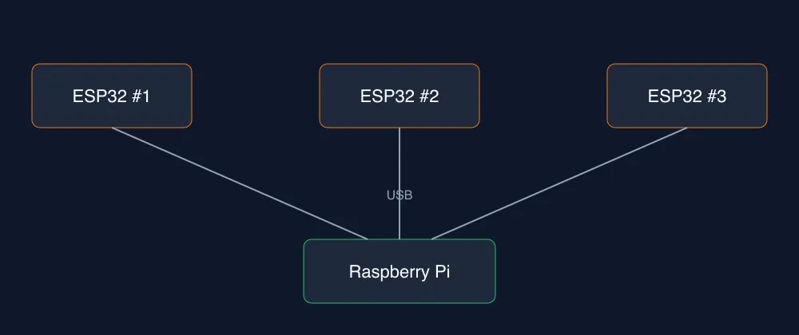

> Reconstruir un hábitat en 3D en tiempo real está muy lejos de ser posible, pero con ESP32 y Wi-Fi CSI puedo intentar algo más modesto: ver la nube de presencia de alguien moviéndose.

Todo empezó con una escena de Prometheus: robots voladores que escanean unas cuevas y mapean en tiempo real cada laberinto. Me puse a investigar qué haría falta para algo así. Conclusión: hoy estamos demasiado lejos, y la razón está en cómo funcionan las radiofrecuencias. Varias cosas de mi carrera de ingeniería me hicieron click con esa explicación.

## Por qué es tan difícil

LiDAR es la tecnología más usada para reconstruir. Se apunta un haz de luz, se espera su rebote y con eso se calcula el trazo. Según lo que entendí, aún no está maduro para mapear un hábitat completo en 3D y en tiempo real. Podría mapear estructuras, pero sin la precisión adecuada. La luz trabaja en longitudes de onda de nanómetros: ve detalles pequeños, pero no atraviesa paredes.

El Wi-Fi tiene el problema opuesto. A 2.4 GHz o 5 GHz la longitud de onda está en centímetros. Atraviesa paredes y puede ubicar objetos en movimiento, pero la señal se dispersa de forma radial y no está focalizada. Con ese tipo de escaneo, llamado CSI, solo ves la nube de algo que se mueve, no su forma.

Se han probado combinaciones de técnicas para ganar precisión. Hoy no es posible y, con lo que conocemos, exige mucho cálculo matemático.

## Una idea que descarté

Imaginé una estructura en el piso: un tubo que subiera un receptor en pasos de milímetros mientras una emisora enviaba la señal. Con cálculo matemático analizaría el rebote en cada paso para cerrar la brecha de centímetros. En papel es posible. En la práctica, al expandirse de forma radial, la señal rebota por todos lados. Por eso se cambió de técnica y se focalizó con láser.

## El experimento

Voy a probar algo más modesto en mis tiempos libres. Necesito tres microcontroladores ESP32, y tiene que ser la versión ESP32-WROOM-32 para usar el modo scanning y monitoring. Los repartiré en una habitación de menos de 5x5 m. Todos escanearán con la librería ESP-CSI y se conectarán por USB a una Raspberry. Ella procesará los datos y generará una web donde pueda ver el movimiento de las personas.

## Qué espero ver (y qué no)

No espero detalle: no voy a ver una pared con una persona detrás, ni sillas ni objetos. Lo que sí quiero es una estimación aproximada de la distancia de la nube, un aura, y cómo se desplaza. De ahí el nombre del proyecto, que aún no defino: Auro, Aurora, Auru. Lo único seguro es que tiene que ver con aura.

## LoRa y el lenguaje

Más adelante quisiera agregar un módulo LoRa a cada ESP32 para enviar la información directo a la Raspberry y ampliar la zona de vigilancia de personas, animales, etc. No se puede mandar todo lo sensado: tendría que viajar solo el evento.

Sin LoRa, estimo unas 10 semanas, con 3 a 4 horas cada fin de semana. No soy muy bueno programando en C, pero habrá que hacerlo en C. Quizá encuentre la manera de hacerlo en Zig, que no intenta reemplazar a C, pero ayuda con la memoria y mantiene el rendimiento de C nativo, sobre todo en electrónica.

## La interfaz

Como desarrollador de software, lo más interesante será la interfaz para ver las nubes. Me da curiosidad replicar el detector de movimiento de las películas de Alien, con su bip que se acerca. Lo haré por juego y por curiosidad.

Ya tengo los ESP32 y en un par de semanas empiezo. Tengo mucho trabajo, así que avanzaré de forma ocasional. Si tengo éxito, les contaré cómo va.
