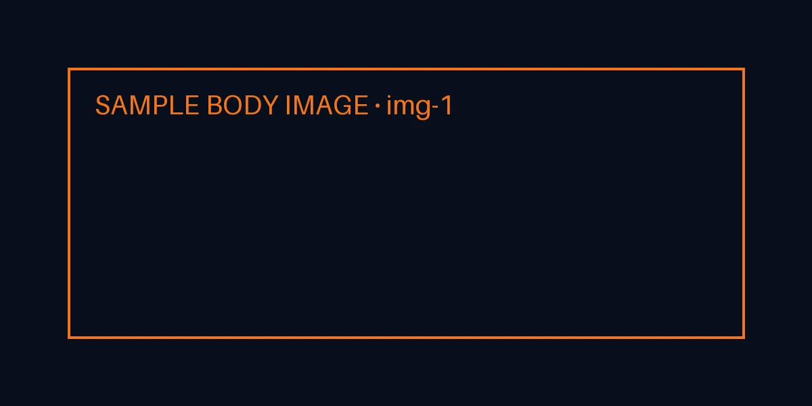

> Sample post to test the design. Deleted before publishing.

## Key ideas

- A green dashboard measures what you already knew how to measure.
- Real incidents live in what you didn't instrument.



```ts
const healthy = (p99: number) => p99 < 300; // { braces } survive
```
