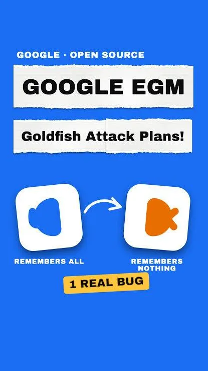

> Un plugin de Google con memoria adaptativa, donde otros agentes validan el trabajo sin memoria, me está ayudando a aprobar tareas con menos tokens y menos retrabajo.

He empezado a probar un plugin que sacó Google llamado [Elephant Golden Fish]. Lo estoy usando para construir un ambiente de desarrollo al que llamo [OrqestrAI].

## Memoria adaptativa por proyecto

Lo que más me interesó es que el plugin permite tener memoria adaptativa con respecto a tu proyecto.

## Agentes sin memoria como validadores

Algunos agentes trabajan desde cero, sin esa memoria. Su función es validar que se haya hecho lo que se definió en un principio. Me parece una idea muy buena y me ha gustado mucho.

## OrqestrAI: Scrum simulado

[OrqestrAI] simula un proceso Scrum para llevar proyectos. Varios agentes tienen roles distintos, como Product Owner, Arquitecto o Scrum Master. La idea es poder ver cómo manejan las tareas.

## Validación entre agentes

El plugin está ayudando mucho para que los agentes se validen entre ellos y puedan aprobar tareas terminadas. Ha reducido bastante el consumo de tokens y el retrabajo.
